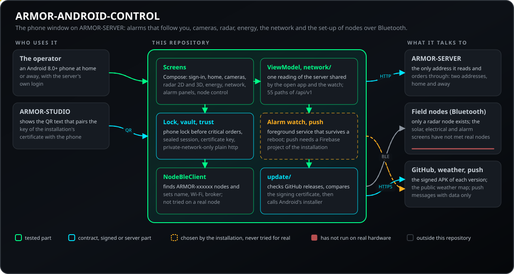
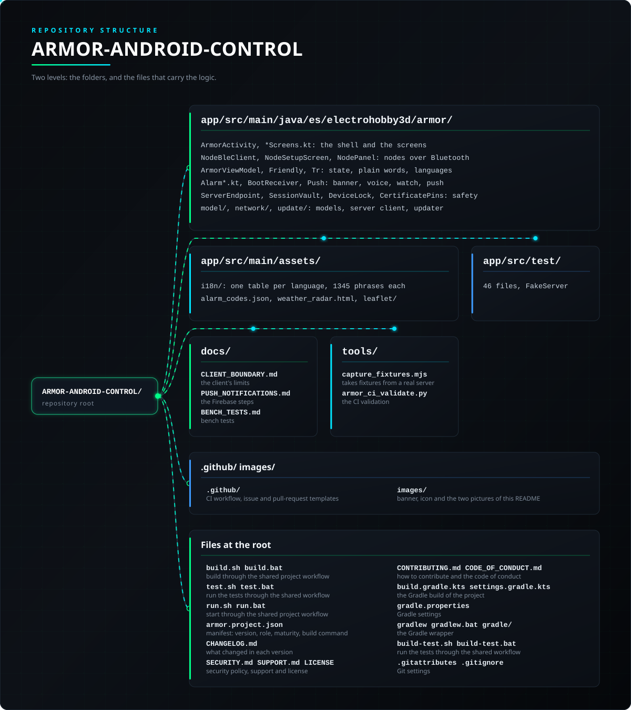

<p align="center">
  
</p>

# 📱 ARMOR-ANDROID-CONTROL

<p align="center">
  <a href="README.md">🇺🇸 English</a> |
  <a href="README_spa.md">🇪🇸 Español</a> |
  <a href="README_fra.md">🇫🇷 Français</a> |
  <a href="README_ita.md">🇮🇹 Italiano</a> |
  <a href="README_deu.md">🇩🇪 Deutsch</a> |
  <a href="README_zho.md">🇨🇳 简体中文</a> |
  🇯🇵 <b>日本語</b> |
  <a href="README_por.md">🇵🇹 Português</a>
</p>

### ARMOR-SERVER のモバイルオペレータークライアント：警報、カメラ、レーダー、エネルギー、ネットワーク、ノードの設定。8 言語対応

<p align="center">
  
  
  
  
  
  
  
</p>

---

**正直さのチェック - 今日動いているもの:** アドレスの安全性、警報の判断、警報ウォッチャー、翻訳、読み取り専用ロールのルールは 342 件のユニットテストでカバーされ、アプリはビルドできます（`gradlew testDebugUnitTest assembleDebug`）。実際のスマートフォンで CM5 テストベンチに対して動作し、サインイン、カメラモニター、警戒と警報、レーダー、Bluetooth でのノード設定、GitHub からのアップデートが使われています。**まだ**証明されていないもの：実機でのソーラー・電気・警報盤の画面（存在するのはレーダーノードのみ）、Firebase 経由のプッシュ（アプリには入っており、独自の Firebase プロジェクトが必要です。実機ではまだ試していません）、各メーカーのバッテリー規則下でのバックグラウンド警報監視。

---

## 📋 ひと目で

| | |
|---|---|
| バージョン | `0.7.7` |
| 成熟度 | 確立 |
| 役割 | ARMOR-SERVER 用の Android オペレーター向けクライアント（ファミリー：Clients、親：ARMOR-SERVER） |
| 技術 | Kotlin / Jetpack Compose, Android 8.0+ |
| テスト | 342 (`gradlew testDebugUnitTest`) |
| 言語 | 8（言語ごとに 1345 フレーズ、すべての表で検査） |
| 動作環境 | Android 8.0+ の電話（minSdk 26） |
| 実機での確認 | 実際のスマートフォンで CM5 テストベンチに対して使用。ソーラー・電気・警報盤の画面は実ノードを待っています |
| ライセンス | GPL-3.0-or-later |

**移動先：** [概要](#-概要) · [アーキテクチャ](#-アーキテクチャ) · [セキュリティ](#-セキュリティと安全) · [インターフェース](#-インターフェース) · [設定](#-設定) · [クイックスタート](#-クイックスタート) · [テスト](#-テスト) · [トラブルシューティング](#-トラブルシューティング) · [構成](#-リポジトリの構成) · [関連](#-関連プロジェクト)

## 🚦 プロジェクトの状況

各行はこのリポジトリの一部分で、信号は今日どこまで進んでいるかを示します。計画ではなく、リポジトリが示せるもの（テスト、ビルド、実行）に基づいて書かれています。

🟢 完了・検証済み · 🟡 動作する（既知の制限あり） · 🟠 一部のみ、または未検証 · 🔴 未実装または動作しない

| 領域 | 状態 | ここでの意味 |
|---|---|---|
| ソフトウェア | 🟢 | アプリはビルドでき（`gradlew testDebugUnitTest assembleDebug`）、実機のスマートフォンで CM5 テストベンチに対して動作しています。 |
| テスト | 🟢 | 342 件のユニットテストが通ります（`gradlew testDebugUnitTest`）：接続先の安全性、警報の判定、警報の監視、翻訳、読み取り専用ロール。 |
| インターフェース | 🟡 | サインイン、カメラモニター、警戒と警報、レーダーは実機のスマートフォンで使われています。Bluetooth でのノード設定は実機のノードではまだ確認しておらず、太陽光・電気・警報パネルの画面も実機の機器とは接続していません。 |
| ハードウェア | 🟡 | 実機のスマートフォンで CM5 テストベンチに対して使っています。各メーカーのバッテリー規則の下でのバックグラウンド警報監視は確認できていません。 |
| セキュリティ | 🟡 | 接続先の安全性と読み取り専用ロールの規則はユニットテストでカバーされています。独立したレビューはありません。 |
| アップデート | 🟡 | GitHub からのアップデートはスマートフォンで使われています。 |
| 連携 | 🟠 | Firebase 経由のプッシュはアプリに入っていますが、専用の Firebase プロジェクトが必要で、スマートフォンではまだ試していません。 |
| ドキュメント | 🟢 | 8 言語と変更履歴は最新です。 |

## 🎯 概要

* **サーバー自身のログインでサインイン：**IP、ポート、ユーザー、パスワード。パスワードは HttpOnly セッションを作ります。スマートフォンに保存されるのは **保存する** にチェックしたときだけです（既定はオフ。ユーザー名とパスワードは Keystore の専用鍵で暗号化され、そのサーバー専用で、チェックを外すと直ちに消去されます）。**viewer** ロールは見るだけで、何かを変更するボタンはすべてオフです。
* **端末のロックによる保護：** アプリは、警戒の開始・解除、サイレン停止、解錠などの重要な命令の前に、端末自体の指紋・顔・PINを求めます（指紋または顔認証がある端末でのみ初期設定でオン）。オンにすればアプリを開くときにも求めます。管理者はStudioから必須にできますが、あなたが選んだ設定を下げることはできません。画面ロックのない端末が締め出されることはなく、ロック画面にはいつでもパスワードで再ログインする手段があります。任意で（既定ではオフ、目立つ警告付き）、保存されたセッションを封じる鍵をスマートフォンのロック解除に結び付けられます。その場合、再起動後はロックを解除するまでバックグラウンドの警報監視が待機します。
* **カメラモニター：**1〜16 タイル、拡大表示、縦横比を保つライブ MJPEG、範囲を限った PTZ パッド、スナップショットと録画（録画にはビューアーと削除確認付き）。
* **警戒と解除：**まず**警戒前のチェック**（開いている、無応答、停止しているもの）を行い、解除には PIN。確認する**警報**（待機中のものにはバッジ）、**デバイス**（煙、ガス、浸水、ドア、窓、動き、気候、プラグ、照明、サイレン、鍵、シャッター、門扉・ガレージドアのモーター、給湯器）の状態とオン / オフ / 切り替え。
* **あなたに届く警報：**重大度ごとの音、任意の**音声警報**、ノードが HIGH になった、カメラが無応答、デバイス警報、（警戒中に）ノードがオフラインになった通知、そして**鳴っている警報盤はスマートフォンを起こします**。バックグラウンド監視は再起動後も残り、サーバー停止中は間隔を空けます。
* **ライブレーダー（2D と 3D）：**レーダータブは Studio で設計したサイトと、レーダーが捉えて動く人を描き、1.5 秒ごとに更新します。3D 表示はドラッグ、ピンチ、回転できます。
* **ソーラーと電気のエネルギー：**合計（太陽、消費、充電状態付きのバッテリー、系統の有無）、各インバーターとバッテリー（セルは要求に応じて）、電気ノードのチャンネルと警報。
* **警報盤：**各 ARMOR-NODE-ALARM ノードの状態、ゾーンとイベント、サーバーが許可した場合の警戒・解除コマンド。
* **ネットワーク：**家のネットワークのデバイス、インターネットの状態、プロバイダーと場所付きの**公開アドレス**（ネットワークノードの報告どおり）。
* **Bluetooth でフィールドノードを設定**（サインイン画面または*その他 > ノードを設定*から）：`ARMOR-xxxxxx` を発信するノードを見つけ、新しいノードの管理者を作るか（ノードの PIN で）サインインし、Wi-Fi ネットワークを検索して、ノード名、ルーターの Wi-Fi または固定アドレス、ブローカーを設定します。**ノードファインダー**はすでにネットワーク上にあるものを一覧します。
* **アシスタント：**文字と音声のコマンド（クローズドなリスト、8 言語、あなたに結び付いた確認）で、家の状態を尋ねたり、警戒、解除、消音、照明のオン・オフができます。
* **証拠ライブラリ、**境界とノードの状態、すべての警報・ノード・カメラ・デバイス・警報・モード変更の**履歴**、**天気マップ**、設備の**サービス**とアップデート。
* **8 言語**（英語、スペイン語、ドイツ語、フランス語、イタリア語、日本語、中国語、ポルトガル語）を*その他 > 設定*で選ぶか端末に従います。すべての文が 8 つの表にあることを検査します。
* **パスワードの扱い：**平文 HTTP は、プライベート LAN またはループバックの IPv4 *リテラル*にのみ許可されます。プライベートアドレスのように始まるだけのホスト名（`10.attacker.example`）や先頭にゼロのあるアドレスは拒否されます。見た目はアイコン中心で、ほぼ黒の面、シアンのアクセント、注意にはアンバーを使います。
* **スマホからのセキュリティ：**2 段階認証と復旧コード、開いているセッション、サーバーから見たスマホの確認、外からの重要な操作での再認証、そして管理者向けに VPN（設定付きの端末）とダイナミック DNS の名前。
* **ステータス画面にシステム全体、そして外からの接続：** ステータス画面は警報パネル、サービス、録画中のカメラ、セキュリティとリモートアクセスをまとめ、各カードがその画面を開きます。入力したアドレスが自宅の外で https でない場合は、サインインが先に進めない理由を示し、2つの安全な方法（VPN、または https の公開アドレス）をガイドが説明します。
* **ノードの状態と警戒モード:** 「その他」にノードの状態画面（稼働時間、再起動の理由、メモリ、回線と信号、ブローカー接続、再起動、最後のエラー、サーバーの警告）があり、警報盤画面にはモード選択（外出、在宅、夜間、独自）があって、ファームウェアが対応していれば選んだモードで警戒します。8 言語対応です。
* **履歴の接続一覧:** 履歴画面に読み取り専用の2つ目の一覧があり、サーバーに接続するデバイスとアプリ（Studio、このアプリ、ノードのパネル、音声サービス）を、最終確認時刻、開いているセッション、サインインと拒否とともに表示します。アプリは自分が何者かをサーバーに伝えるため、自分自身として表示されます。アドレスは管理者にだけ表示されます。
* **バッテリーのメンテナンス（管理者向け）：** Pylontechバッテリーの簡単な操作——時計、カウンタとログ、再起動、容量、MOSFETテスト、ヒューズ故障、出力——を、Studioと同じ2段階（サーバーがノードにバッテリーを読み取らせ、画面に実行内容を正確に表示し、シリアル番号を再入力して「今すぐ実行」）で行い、結果と変更内容を表示します。制限値、ファームウェア、エキスパートコンソールはStudioで行います。
* **ノードの制御（管理者）：** その他 > ノード制御では、Studio と同じ操作（再起動、一時停止、再開、スタンバイ（動作停止、接続は維持）、識別、診断、メンテナンスのオン／オフ）を、1 台または全ノードに対して行えます。ノード名（全ノードの場合は RESTART、PAUSE、STANDBY のいずれかの単語）の再入力と新たな本人確認を求め、各ノードの進み具合を表示し、警報パネルやレーダーが一時停止またはスタンバイのとき家が無防備になることを警告します。工場出荷時リセット、消去、ディープスリープはありません。
* **開いているアプリのアラームウィンドウ：** 確認待ちのアラームがある間、アラーム画面以外のすべての画面の上にバナーが点滅します（重大は赤で速く、それ以外は琥珀色、端末のアニメーションがオフなら静止）。最も重大なアラームと待機件数を示し、その下でアプリを使い続けられます。アラームを開く、バナーから確認する、次のアラームが来るまで閉じる、のいずれもできます。
* **外出先から：** 2 つのアドレス（自宅の Wi-Fi ではプライベートなもの、モバイルデータまたは VPN では外出先用）を端末の場所に応じて選び、一方が応答しなければもう一方を試し、何が失敗したかを表示します。インストールの証明書の鍵は初回に記憶（または Studio の QR のテキストでペアリング）し、異なる鍵は拒否します。一度 https で接続したサーバーへの平文 http は拒否します。ノードのパネルはサーバー経由で開けます。警報はデータのみのプッシュとして届くことがあり、プッシュでも監視でも 1 度だけ通知します。開いているアプリとバックグラウンド監視はサーバーの読み取りを共有します。カメラの映像は画面外で停止し、待ち時間を延ばしながら再開します。

## 🧩 A.R.M.O.R. での役割

ARMOR-ANDROID-CONTROL は [ARMOR-STUDIO](https://github.com/JuanenRac/ARMOR-STUDIO) と同じ [ARMOR-SERVER](https://github.com/JuanenRac/ARMOR-SERVER) へのスマートフォンの窓口で、読み取りも指示もサーバーを通してのみ行います。警報があなたを追いかけ（鳴っている警報盤はスマートフォンを起こします）、アシスタントに声で尋ねられ、現場で新しいノードの横から Bluetooth で設定するためのツールでもあります。

| 名前 | 方法 | 用途 |
|---|---|---|
| ARMOR-SERVER | HTTP `/api/v1` (55 paths), MJPEG | アプリが読み取り・命令するすべて |
| フィールドノード | Bluetooth (`ARMOR-xxxxxx`) | 新しいノードのそばで設定 |
| GitHub | HTTPS | アプリ自身の署名付き更新を確認・取得 |
| Open-Meteo | HTTPS | 天気マップの公開予報、大気質、地名検索 |

## 🏛️ アーキテクチャ

<p align="center">
  
</p>

## 🔒 セキュリティと安全

| 脅威 | 対策 |
|---|---|
| 電話に保存されたパスワード | *ログイン状態を保持*（初期はオフ）のときだけ：ユーザーとパスワードをそのサーバー専用の Keystore 鍵で封印し、チェックを外すと即消去。バックアップなし（`allowBackup=false`） |
| インターネットへの平文 HTTP | プライベート LAN またはループバックの IPv4 *リテラル* にのみ許可。`10.attacker.example` のようなホストや先頭が 0 のアドレス（`010.0.0.1` は 8 進数と解釈）は拒否。https で到達したホストへの平文 http も拒否 |
| https の中間者 | 信頼するのはシステムの認証局と、電話にインストールしたもの。設置環境の証明書の鍵は初回に記憶（または Studio の QR のテキストでペアリング）し、異なる鍵は拒否します |
| 電話が他人の手にあるときの重要な命令 | アーム、ディスアーム、サイレン停止、解錠などの重要な命令の前に、電話の指紋・顔・PIN を要求します（指紋か顔があるときのみ初期でオン）。管理者は Studio から必須にできますが、選んだ水準を下げることはできません。画面ロックのない電話が締め出されることはありません |
| 閲覧者が何かを変更する | *閲覧者* ロールはすべて見られますが、何かを変えるボタンはすべて無効です（ロールのテストあり） |
| 誤った解除 PIN | PIN は解除時にだけサーバーへ送られます。`wrong_pin`、`pin_locked`、`pin_not_set`、`elevation_required` は平易な言葉に翻訳されます |
| 偽のアプリ更新 | Android のインストーラーを呼ぶ前に、インストール済みアプリと候補の署名証明書（履歴）の SHA-256 を比較します。共通するものがなければ、はっきりそう伝えます |
| 電話が気づかないアラーム | フォアグラウンドサービス（`AlarmWatcherService`）が 10 秒ごとに問い合わせ、ロック解除を 15 秒待ち、最大 60 秒まで間隔を延ばし、6 回失敗で*到達不能*と表示し、再起動後も動きます。15 分より古いアラームは通知しません |
| 電話上のカメラのパスワード | カメラはサーバーのストリーム経由で見ます。アプリにはカメラのパスワードも RTSP アドレスもありません |

### 権限

`INTERNET`、`ACCESS_NETWORK_STATE`：サーバー。`USE_BIOMETRIC`：電話のロック。`POST_NOTIFICATIONS`：アラーム。`FOREGROUND_SERVICE`（+ `DATA_SYNC`、`SPECIAL_USE`）と `RECEIVE_BOOT_COMPLETED`：アラーム監視。`REQUEST_INSTALL_PACKAGES`：アプリの更新。`BLUETOOTH_SCAN`、`BLUETOOTH_CONNECT`：ノードの設定。`BLUETOOTH`、`BLUETOOTH_ADMIN`、`ACCESS_FINE_LOCATION` は Android 11 まで（`maxSdkVersion=30`）で、Bluetooth のスキャン用です。

独立したセキュリティレビューはありません。[docs/CLIENT_BOUNDARY.md](docs/CLIENT_BOUNDARY.md) と [SECURITY.md](SECURITY.md) を参照してください。

## 🔌 インターフェース

| 部分 | 設定内容 |
|---|---|
| ARMOR-SERVER | `network/ArmorApiClient.kt` に `/api/v1` の 55 種類のパス（インターフェースは `network/ArmorApi.kt`）。レーダーは 1.5 秒ごとに読み、カメラはサーバー経由の MJPEG |
| 2 つのアドレス | 自宅 Wi-Fi ではプライベートアドレス、外出先ではモバイル通信か VPN のアドレスを電話の場所で選びます。片方が応答しなければもう片方を試し、何が失敗したかを伝えます |
| Bluetooth | `ARMOR-xxxxxx` を発信しているノードを見つけ、新しいノードの管理者を作成するかノードの PIN でサインインし、Wi-Fi を検索して名前・Wi-Fi または固定アドレス・ブローカーを設定します。プロトコルは `model/NodeBle.kt`、ノードファインダーはすでにネットワーク上にあるものを一覧します |
| 音声 | `POST /api/v1/voice/command`：8 言語の固定コマンド一覧と、あなたに結び付いた確認（`model/Voice.kt`、`VoiceScreens.kt`） |
| Push | `PushService`：データのみのメッセージとして届くアラームは、プッシュ経由でも監視経由でも 1 回だけ通知します。Firebase の手順は [docs/PUSH_NOTIFICATIONS.md](docs/PUSH_NOTIFICATIONS.md)（8 言語） |

## ⚙️ 設定

| 名前 | 値 | 設定内容 |
|---|---|---|
| `compileSdk` / `targetSdk` / `minSdk` | 37 / 37 / 26 | 電話は Android 8.0 以降 |
| `versionName` | = `armor.project.json` | マニフェストとバージョンが違うとビルドが失敗 |
| JDK / Android SDK | 17+ / 37 | アプリのビルドとテストの実行用 |

アプリ内（ファイルではなく）：言語（8 言語または電話に従う）、2 つのアドレス、*ログイン状態を保持*、電話のロック、音声アラーム、通知は *その他 > 設定* にあります。コード内の制限：監視は 10 秒ごとに問い合わせ、最大 60 秒まで間隔を延ばし、15 分より古いアラームは無視します。

## 🚀 クイックスタート

**必要なもの:** JDK 17+、Android SDK（compile SDK 37）、Android 8.0+ の電話（minSdk 26）。

```powershell
.\gradlew.bat testDebugUnitTest assembleDebug   # 342 tests, then the debug APK
adb install -r app\build\outputs\apk\debug\app-debug.apk
```

リリースは GitHub で公開され、アプリ自身がそこから更新を確認します。APK は管理者自身のリリース用の鍵（リポジトリの外に保管）で署名されており、アプリはダウンロードしたファイルを Android のインストーラーに渡す前に、その署名証明書を自身のものと照合します。[クライアントの境界](docs/CLIENT_BOUNDARY.md)を参照してください。

## 🧪 テスト

```powershell
.\gradlew.bat testDebugUnitTest
python -I tools/armor_ci_validate.py
```

| 部分 | テスト数 | 対象 |
|---|---|---|
| アラーム | 67 | `AlarmPolicy`、`AlarmBanner`、`AlarmPanels`、`AlarmCodes`、`AlarmRoute`、`NoticeFilter`、`PushEvents`、`DevicesAndAlarms` |
| サーバー接続、解析、試験データ | 59 | `ApiClient`, `ApiError`, `ServerFixtures`, `ParsersTolerant`, `SavePayload`, `JsonText`, `Preflight`, `SharedFeed`, `Connections` |
| ビューモデルとロール | 41 | `ArmorViewModel`, `Viewer`, `ArmProfiles`, `NodeCensus`, `NodeHealth` |
| ロック、セッション保管庫、鍵 | 38 | `DeviceLock`, `SessionVault`, `CredentialVault`, `KeyBinding`, `Security` |
| アドレスの安全性、証明書 | 32 | `ServerEndpoint`, `ServerAddresses`, `Literals`, `NodeAddress`, `CertificatePins`, `RemoteAccess` |
| エネルギーとネットワーク | 34 | `Solar`, `Battery`, `Electrical`, `Network` |
| Bluetooth のノードとノード制御 | 26 | `NodeBle`, `NodeControl` |
| GitHub からの更新 | 17 | `GitHubReleaseUpdaterHttpFailure`, `SignerCheck`, `SemanticVersion`, `ReleaseMetadataParser` |
| レーダーとカメラ | 14 | `RadarGeometry`, `CameraTraits`, `CameraLenses` |
| 翻訳、平易な言葉、音声 | 14 | `Tr`, `Friendly`, `Voice` |

46 ファイル 342 件のテストを `testDebugUnitTest` で実行します。擬似サーバー（`FakeServer.kt`）と実サーバーから取得したデータ（`tools/capture_fixtures.mjs`）を使います。すべてのフレーズが 8 つの言語表にあることも検査します。

## 🏗️ ビルドとリリース

リリースは GitHub で公開され、アプリ自身がそこで更新を確認します。アプリはアセット `ARMOR-ANDROID-CONTROL-release.apk` を探します。APK はリポジトリ外に保管したメンテナー自身のリリース鍵で署名され、アプリはダウンロードした署名証明書を自分のものと比較してから Android のインストーラーに渡します。APK ごとに事前に `versionCode` を上げないと、Android は更新として扱いません。

## 🩺 トラブルシューティング

| 症状 | 原因 | 対処 |
|---|---|---|
| `wrong_pin`, `pin_locked`, `pin_not_set`, `elevation_required` | サーバーが解除 PIN を拒否、または新しい本人確認を要求 | PIN を入れ直す、ロック解除を待つ、または本人確認をする |
| サインインが先に進めない | アドレスが自宅外で https がない（平文 http は拒否） | ガイドに従う：VPN、または https の公開アドレス |
| 動いていた接続が拒否される | 設置環境の証明書の鍵が変わった | 意図して変えたなら Studio の QR テキストで再ペアリング |
| バックグラウンドでアラームが遅れる、または届かない | メーカーのバッテリー制限が監視を止める。プッシュには独自の Firebase プロジェクトが必要 | アプリを省電力の対象外にし、[docs/PUSH_NOTIFICATIONS.md](docs/PUSH_NOTIFICATIONS.md) に従う |
| 更新が拒否される | ダウンロードの署名証明書がインストール済みアプリと共通しない | インストールせず、このリポジトリのリリースから APK を取得する |

## 📂 リポジトリの構成

<p align="center">
  
</p>

<details>
<summary>ツリーのテキスト版</summary>

```text
ARMOR-ANDROID-CONTROL/
├── app/src/main/java/es/electrohobby3d/armor/   アプリ：画面、ルール、ネットワーク、更新
├── app/src/main/assets/                         8 言語の表、アラームコード、天気マップ
├── app/src/test/                                342 件のテストと擬似サーバー
├── docs/                                        このリポジトリのガイド
├── tools/                                       共通の CI チェックとプロジェクトツール
├── .github/                                     CI ワークフローと Issue・Pull Request のテンプレート
├── images/                                      バナー、アイコン、この README の 2 つの図
├── build.sh build.bat                           共通のプロジェクトワークフローでビルド
├── test.sh test.bat                             共通のワークフローでテストを実行
├── run.sh run.bat                               共通のプロジェクトワークフローで起動
├── armor.project.json                           マニフェスト：バージョン、役割、成熟度、ビルドコマンド
├── CHANGELOG.md                                 各バージョンの変更点
├── SECURITY.md SUPPORT.md LICENSE               セキュリティポリシー、サポート、ライセンス
├── CONTRIBUTING.md CODE_OF_CONDUCT.md           貢献方法と行動規範
├── build.gradle.kts settings.gradle.kts         プロジェクトの Gradle ビルド
├── gradle.properties                            Gradle の設定
├── gradlew gradlew.bat gradle/                  Gradle ラッパー
├── build-test.sh build-test.bat                 共通のワークフローでテストを実行
└── .gitattributes .gitignore                    Git の設定
```

</details>

## 🗺️ ロードマップと既知の制限

**現時点の既知の制限**

* ソーラー、電気、アラームパネルの画面は実機に触れていません（レーダーノードしかありません）。
* ノードの Bluetooth 設定は実機で確認しておらず、Firebase のプッシュも電話で試していません。
* 各メーカーのバッテリー制限下でのバックグラウンドのアラーム監視は未証明です。
* 独立したセキュリティレビューはありません。

**今後**

* 実際のノードでソーラー・電気・アラームパネルの画面と Bluetooth 設定を試す。
* 設置環境独自のプロジェクトで Firebase のプッシュを、複数メーカーでアラーム監視を試す。

## 🌍 言語

README とテキストは、英語、スペイン語、フランス語、イタリア語、ドイツ語、中国語、日本語、ヨーロッパポルトガル語で提供されています。

## 🔗 関連プロジェクト

**A.R.M.O.R.**（Autonomous Radar & Multimodal Observation Range）は、独立したリポジトリで構成される境界セキュリティシステムです。各リポジトリは独自のバージョン、テスト、README を持ちます。ファミリーは次のとおりです：

* **[ARMOR-COMMON](https://github.com/JuanenRac/ARMOR-COMMON)** - メッセージのコントラクト、バリデーター、適合ベクトル、生成された型
* **[ARMOR-NODE-RADAR](https://github.com/JuanenRac/ARMOR-NODE-RADAR)** - 3 つのレーダーと独自の Web パネルを備えた ESP32-S3 向けフィールドノードのファームウェア
* **[ARMOR-NODE-SOLAR](https://github.com/JuanenRac/ARMOR-NODE-SOLAR)** - ソーラーインバーターとバッテリーのプロトコル、ゲートウェイノードのメッセージ
* **[ARMOR-NODE-ELECTRICAL](https://github.com/JuanenRac/ARMOR-NODE-ELECTRICAL)** - 電気ノード：メーター、系統の読み取り値のメッセージ、切り替えのルール
* **[ARMOR-NODE-ALARM](https://github.com/JuanenRac/ARMOR-NODE-ALARM)** - 警報ノードとパネル：ゾーン、警戒、遅延、サイレン、PIN。サーバーありでもなしでも動作
* **[ARMOR-NODE-HMI](https://github.com/JuanenRac/ARMOR-NODE-HMI)** - タッチパネル：壁面画面でのシステムの状態、警戒と確認応答、そして音声アシスタントの置き場
* **[ARMOR-NETWORK](https://github.com/JuanenRac/ARMOR-NETWORK)** - ローカルネットワーク：そのデバイス、インターネット、そして変化
* **[ARMOR-SERVER](https://github.com/JuanenRac/ARMOR-SERVER)** - 中央コーディネーター：テレメトリ、警報、デバイス、ソーラーの読み取り値、カメラ
* **[ARMOR-STUDIO](https://github.com/JuanenRac/ARMOR-STUDIO)** - Web コンソール：カメラ、レーダー、警報、太陽光エネルギー、2D/3D のサイトデザイナー
* **ARMOR-ANDROID-CONTROL**（このリポジトリ） - ライブの 2D/3D レーダーを備えた Android オペレータークライアント
* **[ARMOR-IOS-CONTROL](https://github.com/JuanenRac/ARMOR-IOS-CONTROL)** - iPhone オペレータークライアント
* **[ARMOR-SERVER-AI](https://github.com/JuanenRac/ARMOR-SERVER-AI)** - 判断を説明し、決して作動させない視覚推論ポリシー
* **[ARMOR-VISION](https://github.com/JuanenRac/ARMOR-VISION)** - Jetson Orin NX 向けのカメラゾーン、マスク、検出ルール
* **[ARMOR-VOICE-AI](https://github.com/JuanenRac/ARMOR-VOICE-AI)** - 偽造できない確認つきのオフライン音声インテント
* **[ARMOR-HARDWARE](https://github.com/JuanenRac/ARMOR-HARDWARE)** - 筐体、電子回路、ベンチ受け入れマトリクス
* **[ARMOR-DEVOPS](https://github.com/JuanenRac/ARMOR-DEVOPS)** - デプロイ、CM5 テストベンチ、バックアップ、TLS
* **[ARMOR-SIMULATOR](https://github.com/JuanenRac/ARMOR-SIMULATOR)** - 再現可能な障害を持つオフラインのテレメトリシミュレーター
* **[ARMOR-UPDATER](https://github.com/JuanenRac/ARMOR-UPDATER)** - エコシステム自身のリポジトリを検出、インストール、更新
* **[ARMOR-DOCS](https://github.com/JuanenRac/ARMOR-DOCS)** - アーキテクチャ、セキュリティのベースライン、機能マトリクス

## 📚 ドキュメント

* [クライアントの境界](docs/CLIENT_BOUNDARY.md)：クライアントの役割と禁止事項
* [プッシュ通知](docs/PUSH_NOTIFICATIONS.md)：Firebase の手順（8 言語）
* [ベンチテスト](docs/BENCH_TESTS.md)：実機での確認
* [機能マトリクス：何が証明され、何が証明されていないか](https://github.com/JuanenRac/ARMOR-DOCS/blob/main/docs/CAPABILITY_MATRIX.md)
* [プロジェクトカタログ：バージョンと、リポジトリ同士の依存関係](https://github.com/JuanenRac/ARMOR-DOCS/blob/main/docs/PROJECT_CATALOG.md)
* [このリポジトリの変更履歴](CHANGELOG.md)

## 🤝 コントリビュートとコミュニティ

* Pull Request の前に `.\gradlew.bat testDebugUnitTest` and `python -I tools/armor_ci_validate.py` を実行してください。通る必要があります。[CONTRIBUTING.md](CONTRIBUTING.md) と[行動規範](CODE_OF_CONDUCT.md)を参照してください。
* README は 8 言語で提供され、ARMOR-DOCS のソースから生成されます。文面の変更はそちらで行います。
* コンポーネント間のメッセージの変更は ARMOR-COMMON から始めます。
* ビルドしただけのものを、ボード上で動いているかのように書かないでください。
* 脆弱性は非公開で報告してください：[SECURITY.md](SECURITY.md)。質問、アイデア、報告：electrohobby3d@gmail.com（[SUPPORT.md](SUPPORT.md)）。

## 👤 作者

**JuanenRac (Electro Hobby 3D)** · electrohobby3d@gmail.com

## 📜 ライセンス

GPL-3.0-or-later - [LICENSE](LICENSE) を参照してください。
