<p align="center">
  
</p>

# 📱 ARMOR-ANDROID-CONTROL

<p align="center">
  <a href="README.md">🇺🇸 English</a> |
  <a href="README_spa.md">🇪🇸 Español</a> |
  <a href="README_fra.md">🇫🇷 Français</a> |
  <a href="README_ita.md">🇮🇹 Italiano</a> |
  <a href="README_deu.md">🇩🇪 Deutsch</a> |
  <a href="README_zho.md">🇨🇳 简体中文</a> |
  <a href="README_jpn.md">🇯🇵 日本語</a> |
  <a href="README_por.md">🇵🇹 Português</a>
</p>


### Cliente móvel de operador para o ARMOR-SERVER

<p align="center">
  
  
  
  
</p>

---

**Verificação de honestidade - o que funciona hoje:** As regras de segurança dos endereços e de decisão de alarmes têm testes unitários e a aplicação compila. **Não foi executada num telemóvel contra o servidor**, por isso o fluxo da permissão de notificações e o serviço em segundo plano não estão verificados. Armar, os alarmes e os dispositivos seguem as rotas do servidor mas não se experimentaram num telemóvel real.

---

## 🎯 Visão geral

* **Iniciar sessão com o próprio início de sessão do servidor:** IP, porta, utilizador e palavra-passe; a palavra-passe cria uma sessão HttpOnly e nunca se guarda no telemóvel.
* **Monitor de câmaras:** de 1 a 16 mosaicos, uma vista maximizada, MJPEG em direto que mantém a proporção da imagem, um comando PTZ limitado, fotografias e gravações.
* **Armar e desarmar**, após uma confirmação; **alarmes** a reconhecer, com um distintivo para os que esperam; **dispositivos** (fumo, gás, inundação, porta, janela, movimento, clima, fichas, luzes, sirenes, fechaduras) com o seu estado e Ligar / Desligar / Alternar.
* **Radar em direto, em 2D e 3D:** o separador Radar desenha o local tal como foi desenhado no Studio (terreno, edifícios, árvores, postes, os campos dos radares e câmaras) e as pessoas que os radares veem a mover-se nele, atualizado de segundo e meio em segundo e meio; arraste, aperte e rode a vista 3D. A colocação segue as regras do Studio, mas nunca mostrou um radar real.
* **Solar:** uma entrada em *Mais* (e um mosaico no ecrã Estado) mostra as somas (sol, consumo, baterias com a sua carga e fluxo, se a rede está presente) e cada inversor e bateria que o servidor reporta: os seus números, as células de uma bateria a pedido com a mais alta e a mais baixa assinaladas, o equipamento ainda à espera de dados, e uma marca numa leitura de exemplo ou num dispositivo silencioso. Atualizado a cada cinco segundos enquanto está aberto; testado contra as formas que o servidor responde e experimentado num emulador contra um servidor local com leituras de exemplo, nunca com equipamento real. Os alarmes solares (uma avaria de inversor, uma bateria fraca ou a proteger-se, equipamento que ficou em silêncio) acordam o telemóvel como um alarme de dispositivo.
* **Configurar um nó de campo por Bluetooth** (a partir do ecrã de início de sessão ou *Más > Configurar un nodo*): encontra os nós que anunciam `ARMOR-xxxxxx`, cria o administrador de um novo ou inicia sessão, procura redes Wi-Fi e define o nome do nó, o Wi-Fi de um router ou um endereço fixo e o broker, para nós sem cabo Ethernet. Compilado e testado por unidades, nunca executado contra um nó nem um telemóvel.
* **Biblioteca de provas**, o estado do perímetro e dos nós, e um **histórico** de cada alerta, nó, câmara, dispositivo, alarme e mudança de modo.
* **Notificações de alarme** para um nó que chega a ALTO, uma câmara que deixa de responder, um alarme de dispositivo (fumo, gás, inundação, pânico a qualquer hora; um sensor de porta, janela ou movimento com o sistema armado) e, com o sistema armado, um nó que fica desligado; uma vigilância em segundo plano opcional usa a sessão atual e di-lo quando termina.
* **Cuidado com a palavra-passe:** o HTTP simples só se permite para um *literal* IPv4 de rede local privada ou de loopback. Recusa-se um nome de anfitrião que apenas começa como um endereço privado (`10.attacker.example`) ou um endereço com um zero à esquerda (alguns resolvedores leem `010.0.0.1` como o público `8.0.0.1`).
* **Rede elétrica:** uma entrada em *Mais* (e um mosaico no ecrã Estado) mostra a potência da entrada da rede (a tirar ou a injetar na rede), cada canal que os nós elétricos medem (tensão, corrente, potência, energia, frequência, fator de potência, o estado de um interruptor) e os alarmes dos contadores; os alarmes dos nós elétricos (o alarme de um contador, a rede fora de gama, a rede perdida, um nó que deixou de responder) acordam o operador como os solares. O cartão de um inversor mostra também a sua segunda entrada FV e as unidades de um sistema em paralelo.
* **Um aspeto feito de ícones:** superfícies quase pretas, um destaque ciano, âmbar para atenção, ícones grandes com poucas palavras, uma barra inferior, uma página Acerca de e um botão de terminar sessão.

## 📂 Estrutura do repositório

```text
ARMOR-ANDROID-CONTROL/
├── app/src/main/java/es/electrohobby3d/armor/
│   ├── ArmorActivity.kt (the shell), EntryScreens.kt (splash, sign-in, account, About), HomeScreens.kt, CameraScreens.kt, RadarScreens.kt, DevicePanels.kt, MoreScreens.kt, SolarScreens.kt
│   ├── NodeBleClient.kt, NodeSetupScreen.kt   configure a radar, solar or electrical node over Bluetooth (the protocol is in model/NodeBle.kt)
│   ├── ArmorViewModel.kt, Friendly.kt, AlarmPolicy.kt, AlarmNotifier.kt, AlarmWatcherService.kt
│   ├── ArmorTheme.kt, ServerEndpoint.kt, MjpegFeed.kt
│   ├── network/   model/
├── docs/CLIENT_BOUNDARY.md
└── app/src/test/   endpoint-safety, plain-words, node-protocol and solar-model tests
```

## 🛠️ Ambiente de desenvolvimento

```powershell
.\gradlew.bat testDebugUnitTest assembleDebug
adb install -r app\build\outputs\apk\debug\app-debug.apk
```

O APK de depuração não está assinado para distribuição. Veja a [fronteira do cliente](docs/CLIENT_BOUNDARY.md).

## 🔗 Projetos relacionados

O **A.R.M.O.R.** (Autonomous Radar & Multimodal Observation Range) é um sistema de segurança perimetral feito de repositórios independentes. Cada um tem a sua própria versão, os seus próprios testes e o seu próprio README; esta é a família:

* **[ARMOR-COMMON](https://github.com/JuanenRac/ARMOR-COMMON)** - Contratos de mensagens, validadores, vetores de conformidade e tipos gerados
* **[ARMOR-RADAR](https://github.com/JuanenRac/ARMOR-RADAR)** - Firmware de nó de campo para ESP32-S3 com três radares e o seu próprio painel web
* **[ARMOR-SOLAR](https://github.com/JuanenRac/ARMOR-SOLAR)** - Protocolos de inversores e baterias solares e as mensagens de um nó de ligação
* **[ARMOR-ELECTRICAL](https://github.com/JuanenRac/ARMOR-ELECTRICAL)** - Nó elétrico: contadores, a mensagem das leituras da rede e as regras de comutação
* **[ARMOR-HMI](https://github.com/JuanenRac/ARMOR-HMI)** - Painel tátil: o estado do sistema num ecrã de parede, armar e reconhecer, e a casa do assistente de voz
* **[ARMOR-NETWORK](https://github.com/JuanenRac/ARMOR-NETWORK)** - A rede local: os seus dispositivos, a internet e o que muda
* **[ARMOR-SERVER](https://github.com/JuanenRac/ARMOR-SERVER)** - Coordenador central: telemetria, alarmes, dispositivos, leituras solares e câmaras
* **[ARMOR-STUDIO](https://github.com/JuanenRac/ARMOR-STUDIO)** - Consola web: câmaras, radar, alarmes, energia solar e o desenhador de local 2D/3D
* **ARMOR-ANDROID-CONTROL** (este repositório) - Cliente Android de operador com um radar 2D/3D em direto
* **[ARMOR-SERVER-AI](https://github.com/JuanenRac/ARMOR-SERVER-AI)** - Política de inferência visual que explica as suas decisões e nunca atua
* **[ARMOR-VOICE-AI](https://github.com/JuanenRac/ARMOR-VOICE-AI)** - Intenções de voz offline com uma confirmação que não se pode falsificar
* **[ARMOR-HARDWARE](https://github.com/JuanenRac/ARMOR-HARDWARE)** - Caixas, eletrónica e a matriz de aceitação de bancada
* **[ARMOR-DEVOPS](https://github.com/JuanenRac/ARMOR-DEVOPS)** - Implementação, a bancada de testes CM5, cópias de segurança e TLS
* **[ARMOR-SIMULATOR](https://github.com/JuanenRac/ARMOR-SIMULATOR)** - Simulador de telemetria offline com falhas repetíveis
* **[ARMOR-UPDATER](https://github.com/JuanenRac/ARMOR-UPDATER)** - Deteta, instala e atualiza os próprios repositórios do ecossistema
* **[ARMOR-DOCS](https://github.com/JuanenRac/ARMOR-DOCS)** - Arquitetura, linha de base de segurança e a matriz de capacidades

## 📚 Documentação e comunidade

Onde ler mais:

* [Matriz de capacidades: o que está provado e o que não](https://github.com/JuanenRac/ARMOR-DOCS/blob/main/docs/CAPABILITY_MATRIX.md)
* [Catálogo de projetos: versões e como os repositórios dependem uns dos outros](https://github.com/JuanenRac/ARMOR-DOCS/blob/main/docs/PROJECT_CATALOG.md)
* [Registo de alterações deste repositório](CHANGELOG.md)
* [Licença (GPL-3.0-or-later)](LICENSE)
* Perguntas, ideias e relatórios: electrohobby3d@gmail.com

## 👤 AUTOR

**JuanenRac (Electro Hobby 3D)** · electrohobby3d@gmail.com

## 📜 LICENÇA

GPL-3.0-or-later - veja [LICENSE](LICENSE).
